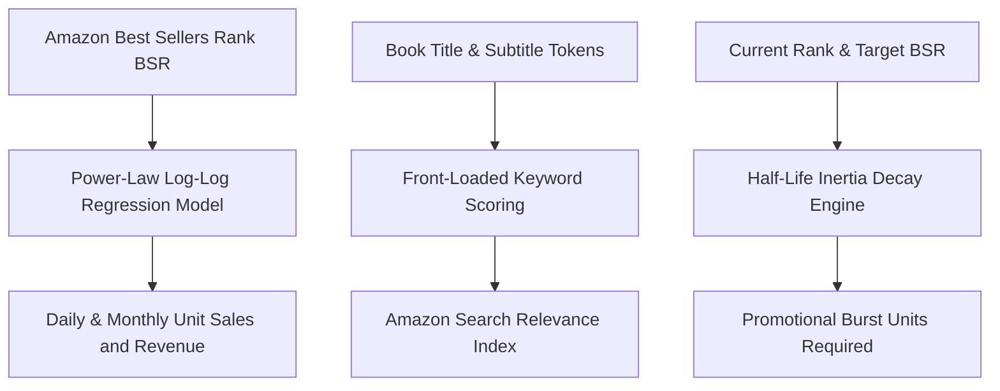

# genpark-amazon-author-ranker


GenPark Amazon Author Ranker is a zero-dependency Amazon KDP publishing and BSR algorithmic analytics engine implementing power-law log-log daily sales velocity conversion models, front-loaded title keyword SEO relevance scoring, and rank decay half-life projection curves.



## Features
- **BSR Sales Velocity Model**: Maps category ranks to exact daily unit velocities and monthly revenue using empirical power-law formulas.
- **Title SEO Keyword Scoring**: Evaluates front-loaded title positioning, subtitle coverage, and search index density.
- **Ranking Decay Half-Life**: Projects natural rank slippage and quantifies the exact promotional sales volume needed to breach bestseller thresholds.

## Quickstart

```python
from client import GenParkAmazonAuthorRanker

ranker = GenParkAmazonAuthorRanker()
res = ranker.estimate_daily_sales_velocity_from_bsr(1000, "books")
print("Daily Units:", res["estimated_daily_sales_units"])
```

## License
MIT
