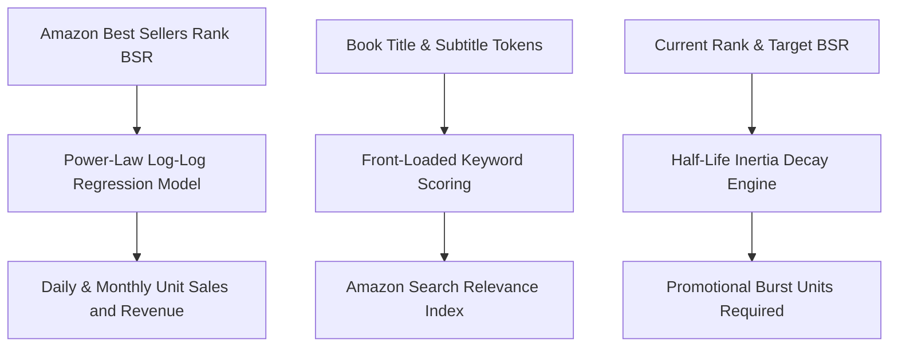

# genpark-amazon-author-ranker


GenPark Amazon Author Ranker has a standard-library core for Amazon KDP publishing and BSR algorithmic analytics engine implementing power-law log-log daily sales velocity conversion models, front-loaded title keyword SEO relevance scoring, and rank decay half-life projection curves.



## MCP runtime requirements

Use Python 3.10 or newer. The core `client.py` uses only the standard library; `mcp_server.py` requires the official `mcp` SDK (`mcp>=1.0.0,<2`). From this repository's checkout, create an isolated environment and install its requirements:

```bash
python -m venv .venv
.venv/bin/python -m pip install -r requirements.txt
```

On Windows, use `.venv\Scripts\python.exe` instead. You may use an existing Python environment with the requirements installed. Configure your MCP client with that interpreter's absolute path and the absolute path to `mcp_server.py`. The client launches a local STDIO process; the GitHub repository URL is not a remote MCP endpoint.

Example client configuration (replace the placeholder paths):

```json
{
  "mcpServers": {
    "genpark-amazon-author-ranker": {
      "command": "/absolute/path/to/genpark-amazon-author-ranker/.venv/bin/python",
      "args": [
        "/absolute/path/to/genpark-amazon-author-ranker/mcp_server.py"
      ]
    }
  }
}
```

## Features
- **BSR Sales Velocity Model**: Maps category ranks to exact daily unit velocities and monthly revenue using empirical power-law formulas.
- **Title SEO Keyword Scoring**: Evaluates front-loaded title positioning, subtitle coverage, and search index density.
- **Ranking Decay Half-Life**: Projects natural rank slippage and quantifies the exact promotional sales volume needed to breach bestseller thresholds.

## Quickstart

```python
from client import GenParkAmazonAuthorRanker

ranker = GenParkAmazonAuthorRanker()
res = ranker.estimate_daily_sales_velocity_from_bsr(1000, "books")
print("Daily Units:", res["estimated_daily_sales_units"])
```

## License
MIT
